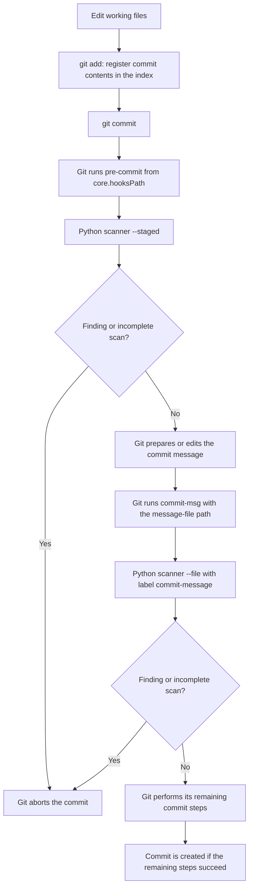

# Python engine: commit hook execution flow

The current implementation also applies shared [publication budgets and static
image validation](images-and-publication.md). Commit budgets run before blob
scanning; push budgets cover newly reachable blobs across all updates. Validated
raster data follows the explicit image allowance instead of text scanning; SVG
remains text-scanned. The text/NUL behavior below describes all other inputs.

Git launches the installed hooks. The local Python scanner then checks its inputs
and returns a status that allows Git to continue or causes it to stop. Codex and
other LLMs do not participate in this runtime decision.

This walkthrough describes the Python engine shipped in this skill, based on
[scan_sensitive.py](../scripts/scan_sensitive.py), the
[hook templates](../assets/hooks/pre-commit), and
[`source_payload()` in the manager](../scripts/manage_hooks.py). The Gitleaks
engine has a [different inspection scope](gitleaks.md).
The Python-only flow does not invoke Gitleaks. The [combined engine](combined.md)
adds a dispatcher that requires both on push. On commit it defaults to Python
only; `--commit-gitleaks on` also enables Gitleaks on both commit hooks.

All paths and bundle identifiers below are placeholders. This document is an
execution explanation, not evidence that hooks are enabled in a particular
repository. For setup and lifecycle operations, see [installation.md](installation.md).

## 1. Why sample files in `.git/hooks` are not the active hooks

The manager sets the repository-local `core.hooksPath` to a versioned bundle's
hook directory. An ordinary checkout can have this layout:

```text
/path/to/repository/.git/secret-checks/bundles/<bundle-id>/
├── hooks/
│   ├── pre-commit
│   ├── commit-msg
│   └── pre-push
└── scripts/
    └── scan_sensitive.py
```

Git uses the configured hook directory and requires executable hook files. The
sample files left under the default `.git/hooks` directory are not part of this
managed execution path. See the [Git hook documentation](https://git-scm.com/docs/githooks#_description).

The skill directory, such as `.agents/skills/secret-checks/`, supplies installation
and management resources. A normal commit executes the copied bundle, so updating
the skill does not automatically update the active hooks. The manager resolves the
Git administration directory through Git; the layout above does not imply that
`.git` is always a directory or that shared worktrees are automatically supported.

## 2. The commit flow



Git invokes `pre-commit` before obtaining the proposed commit message. A nonzero
result from `pre-commit` or `commit-msg` prevents the commit. `pre-push` belongs to
the push path and is not invoked by a normal commit. These are Git's
[hook invocation rules](https://git-scm.com/docs/githooks#_pre_commit).

## 3. What the installed `pre-commit` executes

The manager expands the template with the absolute Python executable resolved
at installation time. A representative generated hook is:

```sh
#!/bin/sh
set -eu
PATH=/usr/bin:/bin
export PATH
bundle=$(CDPATH= cd -P -- "$(dirname -- "$0")/.." && pwd)
exec /path/to/python3 -I -B "$bundle/scripts/scan_sensitive.py" --staged
```

`/path/to/python3` is an illustrative replacement for that interpreter, not a
required system location. The generated command quotes the real executable path
when necessary.

| Part | Purpose |
| --- | --- |
| `set -eu` | Stop for unset variables and applicable shell-command failures |
| Restricted `PATH` | Limit command lookup inside this wrapper to `/usr/bin:/bin` |
| `bundle=...` | Locate the scanner relative to the hook itself |
| Absolute Python path | Use the selected interpreter rather than a later virtual environment or `PATH` change |
| `-I` | Ignore `PYTHON*` environment variables and exclude the script directory and user site-packages from Python's import path |
| `-B` | Avoid writing imported modules' `.pyc` files |
| `exec` | Replace the wrapper process with the scanner and propagate its exit status |

Python's isolated mode is not an OS sandbox. The option behavior is specified in
the [Python 3.10 command-line reference](https://docs.python.org/3.10/using/cmdline.html#cmdoption-I).

## 4. How staged contents are inspected

`scan_staged()` performs four steps. The Git commands below show its conceptual
inputs; the helper actually invokes `/usr/bin/git` with argument arrays, captured
output, and additional controls described in section 6.

### Check whether the repository can be inspected

```sh
git rev-parse --is-shallow-repository
git config --local --list --name-only
```

Shallow history, a local partial-clone key, or a local promisor key makes this
inspection incomplete. The presence of those configuration keys is sufficient
to trigger the check; the scanner does not interpret a false value as permission
to continue.

### Validate entry formats across the whole index

```sh
git ls-files --stage -z
```

Only regular file modes `100644` and `100755`, with index stage `0`, are accepted.
Symlinks, submodules and unresolved conflicts stop inspection. This format check
covers the whole index, including unchanged entries. It does not scan every
unchanged file's content for secrets.

### Select the content inputs

```sh
git diff --cached --name-only -z --diff-filter=ACMR
```

The selected statuses are added, copied, modified and renamed paths. Deleted
paths and other status classes are not selected by this content filter. The
whole-index format check remains a separate step.

NUL-delimited paths and subprocess argument arrays preserve spaces and newlines
in names without shell expansion or splitting filenames into text lines.

### Read the index blob, not the working file

For each selected path, `read_object()` checks its size before reading its bytes:

```sh
git cat-file -s :example.txt
git cat-file blob :example.txt
```

The scanner reads the full selected index blob, rather than only added diff
lines. The following state therefore remains blocked:

```text
Index:        version containing a secret; already staged
Working tree: version with the secret removed; not staged again
```

Fixing only the working tree does not repair the proposed commit. Conversely, an
unstaged working-tree change is not substituted for the index version by this
inspection.

## 5. Detection rules and filename policy

`scan()` applies these 12 regular-expression rule IDs to the content bytes and
the encoded target label, which is the path in staged mode:

```text
private-key
github-token
github-fine-grained-pat
aws-access-key
aws-secret-access-key
google-api-key
jwt
bearer-token
slack-webhook
npmrc-auth-token
pypi-api-token
credential-assignment
```

`credential-assignment` covers selected names such as `password` and
`client_secret` when the assigned value matches its format and length rules.
There is no provider API call to determine whether a credential is valid. A dummy
value that matches a rule can be rejected too.

Separate filename checks reject names such as `.env`, ordinary `.env.*`, `.netrc`,
`credentials.json` and `id_rsa`, and selected extensions such as `.pem`, `.key`,
`.p12`, `.zip`, `.tar`, `.db` and `.exe`. Environment-template endings such as
`.example`, `.sample` and `.template` are excepted from the `.env` name rule, but
their contents are still scanned. The exact lists remain in the scanner source.

## 6. Incomplete inspection also stops the operation

| Condition | Scanner outcome |
| --- | --- |
| Secret rule or filename policy matches | Finding; reject |
| One input exceeds 5 MiB | Incomplete/error; reject |
| Scanned content exceeds 32 MiB or `scan()` receives more than 1,000 inputs in one process | Incomplete/error; reject |
| Content contains NUL | Incomplete/error; reject |
| Recognized Git LFS pointer is present | Incomplete/error; reject because the external content was not inspected |
| Git fails or a required object/input is unavailable | Incomplete/error; reject |
| Git child process exceeds its 30-second timeout | Incomplete/error; reject |
| The hook process reaches its configured 120-second alarm | Incomplete/error; reject |

The Git helper passes `--no-replace-objects` and sets `GIT_NO_REPLACE_OBJECTS=1`,
`GIT_NO_LAZY_FETCH=1` and `GIT_TERMINAL_PROMPT=0`. These disable replacement
objects and request suppression of lazy fetch and interactive authentication.
The scanner itself makes no network API or LLM calls. Those settings do not
isolate an untrusted Git configuration or runtime.

These are processing limits, not OS memory or process isolation. Git metadata
output size is checked after it has been captured. See
[limitations.md](limitations.md) for unsupported inputs and the trust boundary.

## 7. Commit-message inspection

After the staged-content hook passes, Git passes a message-file path to
`commit-msg`. The generated Python invocation has this form:

```sh
exec /path/to/python3 -I -B "$bundle/scripts/scan_sensitive.py" \
  --file "$1" --label commit-message
```

The scanner opens the supplied file in binary mode, reads at most 5 MiB plus one
byte to detect oversize input, and calls the same `scan()` function. A secret in
the message can therefore reject a commit even when the staged source passes.
The scanner does not rewrite the message or automatically remove secrets.

`pre-commit` and `commit-msg` use separate scanner processes, so their content
budgets, counters and hook deadlines are independent.

## 8. Exit status and diagnostics

| Scanner exit | Meaning | Git commit behavior |
| --- | --- | --- |
| `0` | No findings within the configured scope | Continue to the next step |
| `1` | Findings | Abort |
| `2` | Incomplete or failed inspection | Abort |

Git's own nonzero exit code is not guaranteed to equal the scanner's code.
Content findings produce messages in this form:

```text
BLOCK <rule-id> location:<first-16-hex-digits-of-label-sha256>
REJECTED <count> finding(s); matched values suppressed
```

The count is the number of collected rule/target findings, not the number of
secret occurrences. The scanner omits matched values and raw target names. A
location ID identifies the label; it is not a content digest or a bundle-integrity
check. Incomplete input produces a fixed diagnostic:

```text
ERROR input unavailable, unsupported, or scan incomplete
```

Scanner output filtering does not sanitize every message from the calling Git
process, shell tracing or OS monitoring.

## 9. Boundaries and verification evidence

- Rejection does not delete data. The scanner does not repair worktree files,
  the index or history. Staging may already have stored the bytes as local Git
  objects even if no commit is subsequently created.
- A normal commit does not inspect all history. The separate `pre-push` hook
  inspects commit messages and changed blobs in introduced history, including
  merge results. Its Python mode supports branch destinations; unsupported
  destinations and incomplete history stop that check.
- Normal hook invocation does not verify every bundle file's digest. Management
  operations such as `verify` check integrity; hooks execute the installed code.
- Pattern coverage is limited. Unknown or encoded formats can be missed, and
  dummy values can match. Neither a pass nor isolated mode establishes that the
  repository or runtime is secure.
- Local hooks are controlled by the local account and can be bypassed. They do
  not protect other clones, Web/API changes or configure server-side enforcement.

For a particular installation, run the management commands from a reviewed skill
copy, substituting the intended root:

```sh
python3 -B /path/to/skill/scripts/manage_hooks.py inspect --repo /path/to/repository
python3 -B /path/to/skill/scripts/manage_hooks.py verify --repo /path/to/repository
```

`inspect` reports current configuration and inventory without executing the
hooks. `verify` checks the active bundle and effective configuration, then tests
that same bundle in temporary repositories. Its probes include safe commit/push,
staged and message findings, incomplete input, and a finding retained in outgoing
history after removal from the latest tree. They do not create a commit in the
target repository or prove its server-side protection. Tested versions and
unverified environments are recorded separately in [validation.md](../evals/validation.md).
